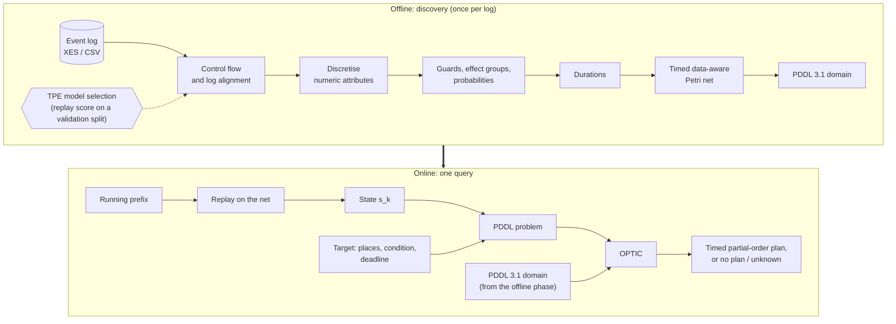

# temporalXes2plan

**Timed situation prescription via temporal planning.**

temporalXes2plan turns an event log into a *timed, data-aware process model* and uses an off-the-shelf
temporal planner to answer what-if questions about running cases:

> *To reach situation X within deadline D, which activities must happen, and when?*

From the event log alone, the tool discovers a Petri net with data guards, data effects, branch
probabilities and duration bounds, and encodes it in PDDL 3.1. A running case (a trace prefix) and a
target become a PDDL problem; the temporal planner [OPTIC](optic/README) returns a **timed,
partially ordered plan** that runs independent activities in parallel and respects every guard, effect
and duration bound of the model, or reports that the model admits none.

Answers are:

- **sound** with respect to the discovered model: every plan is an execution of the net that reaches the target in time;
- **transparent**: each step carries its start time, its duration bounds and the condition that enables it, so an analyst can trace and check it;
- **honest about failure**: a deadline the model cannot meet is reported as such (no plan), and `unknown` is returned only when a time or memory limit is reached.

## How it works



**Offline.** The control flow is discovered with one of five miners (`powl`, `inductive`, `alpha`,
`heuristics`, `ilp`) and the log is replayed on the net so that every event is attached to a transition
and a choice point. Numeric attributes are discretised with optimal one-dimensional clustering
(Ckmeans.1d.dp) and kernel-density peaks; guards of exclusive choices are learned with a cascade of
determinism thresholds and decision trees; conditional effects are split into appearance, value
assignment and grouping; durations come from lifecycle events (start/complete), from the time to the
next event, or from user-supplied bounds. The many thresholds of these steps are tuned automatically
with a Tree-structured Parzen Estimator (Optuna) and successive halving, scoring each candidate net by
how many validation traces it can replay.

**Online.** The prefix of a running case is replayed on the net to obtain a state (marking and attribute
values). Together with a target (places to mark, a condition on data, a deadline) it becomes a PDDL
problem. The deadline is a timed initial literal that disables every action once it has passed, so it is a
hard constraint. OPTIC returns a plan whose actions map back to transitions, effect groups and attribute
values.

## Features

| Area | What it offers | Where |
|---|---|---|
| Event logs | XES and CSV loading, validation, lifecycle handling, variant-coverage filtering | `src/parsing/log_*.py`, `csv_loader.py` |
| Control flow | `powl`, `inductive`, `alpha`, `heuristics`, `ilp` discovery; alignment-based replay that tolerates low fitness | `src/parsing/model_discoverer.py`, `petri_net_log_builder.py` |
| Data awareness | Decision-tree guards for exclusive choices, conditional effects, effect co-occurrence analysis, branch and effect probabilities | `src/parsing/decision_mining.py`, `effect_correlation_analyzer.py`, `probability_estimator.py` |
| Discretisation | Bounded intervals for numeric attributes (kernel-density peaks + Ckmeans.1d.dp with variance-fit selection of k) | `src/parsing/discretizer.py` |
| Attribute filters | Automatic removal of noise attributes (constant, long text, counter-like) and of attributes no guard reads | `src/parsing/attribute_filter.py`, `src/encoding/domain_builder.py` |
| Durations | Duration bounds from lifecycle events, inter-event times or external data | `src/parsing/temporal_extractor.py` |
| Model selection | Hyperparameter search (TPE, successive halving, exact early stopping of replays, feasibility gate on effect-group blow-up) | `src/network_search/` |
| PDDL encoding | PDDL 3.1 domain with durative actions, `total-cost` and `deadline_ok`; PDDL problems from a state, a target and a deadline | `src/encoding/` |
| Planning | OPTIC (temporal, partial-order) and Fast Downward (classical); timeouts, memory limits, a timed run that splits grounding from planning | `src/planning/` |
| Replay and validation | Replay of traces on the net and validation of planner plans against the domain | `src/replay/` |
| Web interface | Upload and validate a log, run the pipeline as a background job, inspect and correct the discovered net, pose queries from a prefix | `src/web/` |
| Evaluation | Two evaluation harnesses (see below) and SQL-queryable results (DuckDB) | `src/evaluation/`, `src/paper_eval/` |

## Repository layout

```
temporalXes2plan/
├── README.md
├── LICENSE                      # GPL-3.0
├── environment.yaml             # conda environment (Python 3.12 + pip packages)
├── src/
│   ├── main.py                  # command-line pipeline: log -> PDDL domain
│   ├── pipeline.py              # pipeline coordinator (parse -> search -> encode -> persist)
│   ├── models.py                # data model and AnalysisConfig (all tunable parameters)
│   ├── core_utils.py            # logging, name sanitising, train/test splitting, XES writing
│   ├── parsing/                 # log loading, discovery, decision mining, discretisation, durations
│   ├── encoding/                # PDDL model, domain and problem builders, guard/effect encoders
│   ├── network_search/          # TPE model selection: search space, scoring, early stopping
│   ├── replay/                  # trace replayer (alignment + walk) and plan replayer
│   ├── planning/                # OPTIC and Fast Downward wrappers, planner dispatcher and config
│   ├── web/                     # Flask application, REST API, job tracker, templates, static files
│   ├── evaluation/              # first evaluation harness (Q1/Q2/Q3 queries on public logs)
│   └── paper_eval/              # evaluation protocol of the paper: phases, results, SQL tables
├── optic/                       # OPTIC temporal planner (sources; own licence, see below)
├── vendor/downward/             # Fast Downward (git submodule)
├── scripts/                     # setup.sh (build Fast Downward), setup_submodules.sh
├── tests/                       # test suite (mirrors the layout of src/)
├── docs/                        # module reference and evaluation documentation
├── figures/
├── data/                        # created at run time, not versioned: logs, UI data
└── results/                     # created at run time, not versioned: evaluation results
```

## Installation

**Prerequisites** (Linux; the commands below assume Debian/Ubuntu):

```bash
sudo apt install git cmake g++ python3 perl bison flex libbz2-dev \
                 coinor-libcbc-dev coinor-libclp-dev coinor-libcoinutils-dev
```

`cmake`, `g++` and `python3` are needed for Fast Downward; the rest is needed to build OPTIC
(see [`optic/README`](optic/README)). The timed runs of the evaluation use `stdbuf` from GNU coreutils.

**Clone and create the environment:**

```bash
git clone --recurse-submodules <repository-url>
cd temporalXes2plan
conda env create -f environment.yaml
conda activate temporalXes2Plan
```

The environment installs Python 3.12 and the pip packages listed in `environment.yaml` (PM4Py, Optuna,
scikit-learn, NumPy, pandas, SciPy, Flask, DuckDB, `ckwrap`, ...).

**Build the planners:**

```bash
# Fast Downward (initialises the submodule if needed, then compiles it)
bash scripts/setup.sh

# OPTIC (CLP variant): configure and compile in optic/
cd optic && bash run-cmake-release && bash build-release && cd ..
```

OPTIC can also be built from Python, and the first call of `planning.optic.run` builds it automatically
if the binary is missing:

```bash
PYTHONPATH=src python -c "from planning import optic; print(optic.build(print)['message'])"
```

The timed runner used by the evaluation (`planning.optic.run_timed`) does **not** build OPTIC: build it first.

All commands below are run from the repository root with `PYTHONPATH=src`.

## Quick start

### Command line: from a log to a PDDL domain

```bash
PYTHONPATH=src python -m main --log path/to/log.xes --durative --algorithm powl
```

| Option | Meaning |
|---|---|
| `--log PATH` | XES event log (required) |
| `--algorithm` | `alpha`, `inductive` (default), `heuristics`, `ilp`, `powl` |
| `--durative` | encode transitions as durative actions with duration bounds |
| `--coverage FLOAT` | minimum cumulative variant coverage kept in the log (default `0.001`) |
| `--activity-classifier` | use `concept:name` + `lifecycle:transition` as the activity label |
| `--domain-name NAME` | domain name in the PDDL header (default: log file name) |
| `--data-dir DIR`, `--pddl-out DIR` | where the UI data (`data/<log>/`) and the PDDL domain (`pddl/`) are written |

The run writes the discovered model as JSON for the web interface (`original.json`, `current.json`) and the
PDDL domain file. The model search of the previous section is available from the web interface and from the
Python API (`search=True`).

### Web interface

```bash
PYTHONPATH=src python -m web.app            # --port 5000 --no-browser --data-dir DIR --debug
```

The interface lists the available configurations (one per log) and lets you:

- upload a log (XES or CSV, with column mapping) and validate it;
- choose the analysis parameters and run the pipeline as a background job with progress;
- open the discovered Petri net, inspect transitions, XOR splits, guards, effects and durations, edit them,
  reset to the automatic version, import and export the model;
- pose a query from a trace prefix: replay the prefix, build the PDDL problem (with target and deadline),
  run OPTIC or Fast Downward and read the plan.

### Python API

```python
from evaluation.eval_api import EvalAPI

api = EvalAPI()

# 1. Discover the model and encode the domain (add search=True to tune the parameters with TPE)
built = api.build_network("path/to/log.xes", domain_name="process",
                          use_durative=True, use_costs=True, discovery_algorithm="powl")
serialized = api.serialize(built.prepared, built.parse_result)    # same shape as the web UI's current.json
start = serialized["metadata"]["start_place"]

# 2. Pose a query: complete the case from an initial marking (add deadline=... for a deadline;
#    divide it by built.domain.duration_scale_factor, the domain may rescale durations)
problem = api.build_problem(serialized, init_places=[start], goal_sop=[[]], require_completion=True,
                            temporal=True, metric="minimize_cost", domain_name="process")

# 3. Plan
plan = api.run_planner(str(built.domain), problem, planner="optic",
                       timeout=60, memory_mb=4000, stop_at_first=True)
print(plan.solvability, plan.plan_steps, plan.duration_s)
```

## Planners

| Planner | Kind | Use |
|---|---|---|
| **OPTIC** (`optic/`) | temporal, forward-chaining partial-order | the prescription: durative actions, timed initial literals, metrics `total-cost` / `total-time` |
| **Fast Downward** (`vendor/downward`) | classical | totally ordered plans; the search configurations available are listed in `planning/fast_downward.py` |

`planning.planner_runner.run_planner` dispatches to either. OPTIC runs in its own process group under a
wall-clock timeout and an address-space limit (`ulimit -v`), so that a timeout stops the whole process
chain; Fast Downward gets a timeout and its own `--overall-memory-limit`. Per-configuration planner
settings are kept in `planner_config.json` (`planning/planner_config.py`) and are editable from the web
interface.
`planning.optic.run_timed` additionally reads OPTIC's output as a stream and timestamps it, which gives the
*grounding time* (until the initial heuristic is evaluated) and the *planning time* (until the first plan)
separately.

## Evaluation of the paper (`paper_eval`)

`src/paper_eval/` implements the evaluation protocol of the paper as resumable phases, one command each.

**Protocol.** Each log is split chronologically (first 70% of the cases for discovery, last 30% for testing;
`--drop-spanning` can take out of the discovery part the cases still running when the test period starts, it is
off by default). Model selection uses only the discovery
portion, whose last 20% is the validation split. Every test trace of length `n` contributes the prefixes of
length 2 to `n-1`; results are reported per prefix-length bucket, with timeouts and out-of-memory errors
reported separately. Identical inputs (same prefix, same initial state, same goal) are evaluated once.

Eight public logs are registered in `paper_eval/config.py` (Sepsis, Road Traffic Fines, BPIC 2012 A and W,
BPIC 2013 closed problems and incidents, BPIC 2017, Helpdesk), downloaded from a pinned commit of a public
repository and checked against a SHA-256 checksum.

```bash
PYTHONPATH=src python -m paper_eval.run --log sepsis --phase all     # prepare + split + model + prefixes
PYTHONPATH=src python -m paper_eval.run --log sepsis --phase plan    # OPTIC on every instance (not in "all")
```

| Phase | What it does | Main output (`results/paper_eval/<log>/<split_hash>/` unless noted) |
|---|---|---|
| `prepare` | downloads the log, normalises it (UTC, sorted events, `start`/`complete` only, traces with fewer than 3 events dropped; for BPIC 2013 incidents, whose `lifecycle:transition` holds sub-statuses, the activity is status and sub-status together) | `data/paper_eval/<log>.xes`, `<log>.stats.json` |
| `split` | chronological split, removal of cases spanning the split point, validation set | `results/paper_eval/<log>/split.json` |
| `model` | TPE search on the training part, final net, PDDL domain | `current.json`, `domain.pddl`, `petri_net.png`/`.svg` (picture of the net), `analysis_config.json`, `model_meta.json`, `search_trials.json`, `attribute_filter.json`, `attributes.jsonl`, `transition_durations.jsonl` |
| `prefixes` | every prefix of every test trace, replay on the model, ground truth, goals, deduplicated instances | `prefixes.jsonl`, `instances.jsonl`, `prefix_stats.json` |
| `volume` | number of prefixes per bucket, without building a model | `results/paper_eval/<log>/volume.json` |
| `plan` | OPTIC on every instance, one at a time, resumable, with time and memory limits | `plan_results.jsonl`, `plan_meta.json` |
| `rq2` | OPTIC optimising total-time (no costs, no deadline) on the completion instances, every plan saved; meant for the factory log | `rq2_results.jsonl`, `rq2_plans.jsonl`, `rq2_plan_steps.jsonl`, `rq2_domain.pddl`, `rq2_meta.json` |
| `stats` | descriptive statistics of the model (places, transitions, attributes, durations) | `model_stats.json` |
| `report` | RQ1 summary (grounding and planning time per bucket, by status); RQ2 summary when the `rq2` phase has run | `rq1_summary.json`, `rq1_summary.md`, `rq2_summary.json`, `rq2_summary.md` |
| `query` | SQL over all results with DuckDB | printed table |

Useful options: `--force` recomputes a phase; `--unit-costs` / `--no-unit-costs` (model phase) gives every PDDL action cost 1 instead of the −log(probability) costs (default: `PaperEvalConfig.unit_costs`); `--limit N`, `--timeout S`, `--memory-mb M` and
`--goal completion|deadline|all` control `plan`; `--noise-filter` / `--unused-filter` switch the two
automatic attribute filters.

**Querying the results.** Every result is a table in an in-memory DuckDB database (`paper_eval/query.py`):
`runs`, `logs`, `case_split`, `models`, `search_trials`, `attributes`, `transition_durations`, `prefixes`,
`instances`, `plan_meta`, `plan_results`, `rq2_meta`, `rq2_results`, `rq2_plans`, `rq2_plan_steps`, plus the views `cases` (one row per case, prefix and goal, with the
planner outcome of its instance), `instances_view` and `rq2_reference` (the best RQ2 plan against the test cases with the same prefix). Nested columns are read with a dot:

```bash
PYTHONPATH=src python -m paper_eval.run --log sepsis --phase query \
    --sql "SELECT status, count(*), avg(planning_s) FROM plan_results GROUP BY status"

PYTHONPATH=src python -m paper_eval.run --log sepsis --phase query --all-logs \
    --sql "SELECT log, petri_net.places, petri_net.transitions, pddl.actions FROM models"
```

The schema, with a note on every table and column, is in [`docs/PAPER_EVAL_FLOW.md`](docs/PAPER_EVAL_FLOW.md)
and, as an interactive diagram, in [`docs/paper_eval_er.html`](docs/paper_eval_er.html).

**Reproducibility.** The launcher fixes `PYTHONHASHSEED`, the TPE is seeded, and two runs of `model` produce
identical files; `plan` writes a line per instance as soon as it is done and resumes where it stopped, and it
refuses to mix results made with different settings (use `--force` to start over).

**RQ2.** The `rq2` phase runs OPTIC without `-N`, on a domain without action costs, with the metric
`total-time` and no deadline, so that the plan is the fastest completion OPTIC finds. Every plan OPTIC prints is
saved, with the activities of the log, and `search_completed` says whether OPTIC ended by itself or was stopped by
the time limit. Nothing is compared while running: the reference trace (a test trace with the same prefix whose
continuation is the sequence of activities of the plan, in order of start time) and the differences are computed
afterwards from the `rq2_reference` view and by `--phase report`. It is meant for the learning-factory log, which
is registered as `factory` and must be copied by hand to `data/paper_eval/raw/fabbrica_2vgr_normalizzato.xes`.

**Status.** The phases up to RQ1 (grounding and planning time) and the RQ2 phase are in place; the final results
are not part of the repository yet.

## First evaluation harness (`evaluation/`)

`src/evaluation/` is an earlier harness that evaluates the pipeline on logs of a public collection of 98
event logs (Zenodo). For one log (`--log-id`) it downloads the log, makes a stratified train/test split,
samples one prefix per test trace and builds three kinds of query: **Q1** (complete the case), **Q2**
(complete it within the remaining time) and **Q3** (reach the end with the data values observed in the real
final event). Each query is solved with OPTIC under retries and timeouts, the plan is replayed to validate it,
and per-query metrics and a per-log summary are written under `src/evaluation/results/`.

```bash
PYTHONPATH=src python -m evaluation.run_evaluation --log-id 55 --planner-timeout 60
```

## Tests

```bash
PYTHONPATH=src python -m pytest tests -q -p no:warnings                  # unit tests
PYTHONPATH=src python -m pytest tests -q -p no:warnings -m integration   # also builds real networks and runs planners
PYTHONPATH=src python -m pytest tests/paper_eval -q -p no:warnings       # one component
```

Tests that build real networks or call a planner are marked `integration` and are skipped unless `-m
integration` is given (OPTIC-dependent ones also skip if the binary is not built).

| Folder | What it checks |
|---|---|
| `tests/parsing/` | log loading and validation, preprocessing, discovery (including canonical net form), replay, decision mining, discretisation, effect analysis, probabilities, durations, attribute filter, the parser facade |
| `tests/encoding/` | PDDL model rendering, guard and effect encoders, prepared input, domain and problem builders |
| `tests/network_search/` | search space, score composition, exact early stopping, metrics, the search runner |
| `tests/replay/` | trace replayer (alignment and walk) and plan replayer |
| `tests/planning/` | OPTIC wrapper (output parsing, timeouts, timed runs with a fake planner, duration semantics), planner configuration and dispatcher |
| `tests/evaluation/` | evaluation API, log downloader, query builder, metrics, retry runner, report generator, test-case selector, trace sampler |
| `tests/paper_eval/` | configuration, preparation, splits (including spanning cases), prefixes and deduplication, model tables and statistics, the plan phase with a fake OPTIC, the report, the DuckDB tables, and an end-to-end run on a small synthetic log |
| `tests/web/` | REST API, partial-trace replay endpoint, job tracker, problem builder |
| `tests/*.py` | analysis configuration, core utilities and splitting, guard model, pipeline with model search |

## Documentation

- [`docs/parsing_module_reference.md`](docs/parsing_module_reference.md): technical reference of the parsing package.
- [`docs/PAPER_EVAL_FLOW.md`](docs/PAPER_EVAL_FLOW.md): the evaluation flow phase by phase, the tables each phase creates and the ER diagram.
- [`docs/paper_eval_er.html`](docs/paper_eval_er.html): the same schema as an interactive page (open it in a browser).
- Module docstrings under `src/` describe each component; `AnalysisConfig` in `src/models.py` documents every tunable parameter.

## Data and reproducibility notes

- `data/` and `results/` are created at run time and are ignored by git.
- The public logs of `paper_eval` come from a pinned commit of a public repository and are verified by
  checksum (`src/paper_eval/config.py`).
- Seeds: the model search takes a seed (`PaperEvalConfig.seed`, default 42); results do not depend on hash
  ordering because the launcher of `paper_eval` re-executes itself with a fixed `PYTHONHASHSEED`.

## License and third-party components

The code of this repository is released under the **GNU General Public License v3.0** (see [`LICENSE`](LICENSE)).
Bundled and external components keep their own licences:

- **OPTIC** (`optic/`): GNU General Public License v2 (see [`optic/LICENCE`](optic/LICENCE)); it is a separate
  program, invoked as an external process.
- **Fast Downward** (`vendor/downward`, git submodule): its own licence (GPL).
- Python dependencies (PM4Py, Optuna, scikit-learn, DuckDB, Flask, ...) under their respective licences.

## Citation and acknowledgements

Citation details will be added after the review of the accompanying paper.

This work builds on an earlier XES2Plan prototype that framed predictive process monitoring as classical
planning over a data-aware Petri net; the timed model, the temporal encoding, the model selection and the
evaluation in this repository are new.
